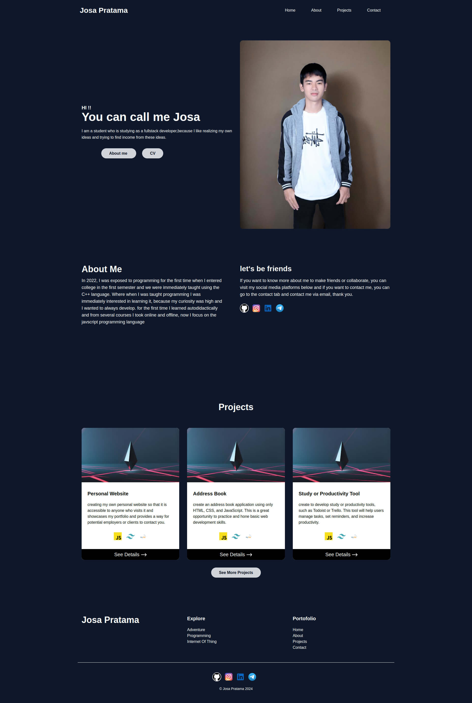

# Josa Pratama Portfolio Website (josapratama.com) 🌐✨

Selamat datang di repositori website portfolio resmi **Josa Pratama**! Website ini menampilkan profil profesional, keahlian teknis (tech stack), showcase proyek, serta formulir kontak kolaborasi.


---

## 📑 Struktur Halaman

1. **Homepage (`/`)**: Perkenalan, highlight keahlian teknologi, dan ringkasan profil developer.
2. **Projects (`/projects/`)**: Galeri portofolio proyek lengkap dengan screenshot dan teknologi yang digunakan.
3. **Contact (`/contact/`)**: Formulir interaktif untuk pertanyaan, konsultasi, atau penawaran kerja sama.

---

## 🔗 Tautan & Sosial Media

- **Website**: [josapratama.com](https://josapratama.com)
- **GitHub**: [github.com/josapratama](https://github.com/josapratama)
- **LinkedIn**: [linkedin.com/in/josapratama1234](https://www.linkedin.com/in/josapratama1234)
- **Instagram**: [@josapra_](https://instagram.com/josapra_)
- **Telegram**: [@josa_pra](https://t.me/josa_pra)
- **Desain UI (Figma)**: [Figma Design Canvas](https://www.figma.com/file/kvcbw99fQjHNTjK2ASVMco/Josa-Pratama?type=design&node-id=0-1&mode=design&t=ZGQxHfbuon8f2cgL-0)

---

## 🚀 Panduan Pengembangan & Build

### 1. Instalasi Dependensi
```bash
bun install
# atau
npm install
```

### 2. Mode Pengembangan (Hot Watch Tailwind)
```bash
bun run dev
# atau
npm run dev
```

### 3. Build Produksi (Minified CSS)
```bash
bun run build
# atau
npm run build
```
File stylesheet hasil kompilasi akan otomatis disimpan di `./public/css/output.css`.

---

## 🖼️ Tampilan Desktop



---

## 📄 Lisensi

Didistribusikan di bawah lisensi MIT. Dibuat oleh [@josapratama](https://github.com/josapratama).
